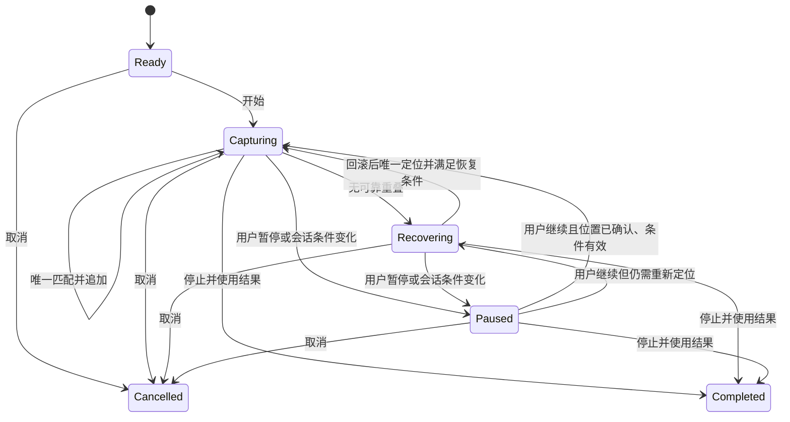

# GridStruct 五项主链路改进总 spec

状态：v0.4，用户已认可 spec，阶段 A 和后续 B–D 均已授权实施并完成源码验收。设备、样本与发布包验证边界见各阶段验收记录。

日期：2026-10-11。源码调查基线：`761127d072ab4ad5769f04815e268635a0eee63a`。

## 目标与已确认决策

改善长截图的连续采集，以及 OCR 从识别、校正到贴图复用的完整流程。沿用 Windows、普通 CPU、本地模型、离线使用与便携数据约束。复用 PixPin 的职责分层与交互经验，不复制其私有代码或模型，也不将其静态结构当作性能保证。

用户已确认：

1. 五个改进方向形成总 spec，再分阶段实施。
2. 长截图当前确实存在匹配慢、快速滚动无法匹配的问题，具有改进价值。
3. 长截图失去重叠时采用非弹窗提示；用户回滚到已采集区域后自动恢复。
4. 先形成 spec 并对齐；2026-10-11 用户确认“spec 没问题”，授权先实施阶段 A。
5. OCR 采用逐条/逐段校正并同步原图；全文自由编辑作为独立导出草稿。
6. 自动长截图回滚定位成功后，鼠标仍在原选区且目标窗口未变时自动继续，否则暂停。
7. OCR 结果和人工校正随贴图保存，重启后恢复并继续复核。
8. 阶段 A 完成后，用户明确要求“继续推进后续阶段”，授权 B–D 实施和验收。

五项范围：

| 编号 | 方向 | 预期用户收益 |
|---|---|---|
| LS | 长截图区域采集、快速匹配与恢复 | 快速滚动更容易接上，失配后能继续，已有结果不丢失 |
| DATA | 保留原始 OCR 几何与文字，独立组织版面 | 排序、校正和旋转文字有可追溯的数据基础 |
| REVIEW | OCR 校正与原图文字层联动 | 找到错误、改正一次，复制与贴图保持一致 |
| TASK | OCR 排队、加载和识别状态 | 用户知道正在等什么，取消和重试行为可预期 |
| TRANSFER | 截图转贴图复用 OCR 结果 | 相同图像不必再次识别，已做校正随内容保留 |

表格、公式和新增贴图类型仍按现有 P1 范围另行规划。本 spec 不引入账户、云端同步、录屏剪辑、通用插件机制或新的模型选型。

## 现状与证据

下文 `.scratch/` 引用为本机调查与验收证据，不随 Git 提交；产品源码、正式验收脚本和阶段摘要在仓库内保留。历史复现脚本和调查记录需要在原验收机器查看。

### 长截图已复现的问题

重放命令：

```powershell
& .venv\Scripts\python.exe .scratch\longshot-debug-20261011\reproduce.py
```

该脚本使用离屏合成页面，直接调用现有 ImageStitcher，不抓取用户桌面。视口为 1200×900 物理像素。

| 场景 | 当前结果 | 判断 |
|---|---|---|
| 纵向位置 0、137、274 | 最终 1174px，像素一致；热态追加约 186ms | 正确，但匹配成本超过当前 50ms 采样间隔 |
| 位置 0、852、1704；相邻重叠仅 48px | 接受状态 true/false/true；最终 1304px，应为 2604px | 快速滚动匹配失败；后续无真实重叠的相似内容被错接 |
| 位置 0、137、176；最后增量 39px | 最终 1076px，像素一致；追加约 186–190ms | 小步输出应作为保留行为 |

首次普通追加测得约 1301ms，包含延迟导入等冷启动成本，不能与热态耗时混算。另一次同样页面的 profile 为 189ms，其中 `_overlap_score` 累计 1147 次调用、171ms；这些是局部合成场景测量，尚不是实机 P95。

静态定位：`LongShotFlow._grab()` 每次先 `capture_virtual_desktop()` 再裁剪；匹配在 GUI 定时器回调中同步执行；`find_overlap` 默认最小重叠限制为 80px。上述事实解释了值得验证的改进点，最终方案仍须用原重放和实机证明。

证据入口：[复现脚本](../../.scratch/longshot-debug-20261011/reproduce.py)、[长截图实现](../../capture/longshot.py)、[屏幕采集实现](../../capture/screen.py)、[PixPin 静态调查](../../.scratch/pixpin-re-20261011/README.md)。测量是本轮诊断记录，不是优化后的结果。

### OCR 已有基础

- OCREngine 懒加载并复用 RapidOCR 实例，后台任务串行执行；无需重新设计一层通用模型缓存。
- OCRResult 已有矩形、文字、置信度、段落和行号；四点框被折叠为轴对齐矩形，返回结果已经过排版。
- 原图可选文字层、全文编辑、结果对话框已经存在；全文编辑与图层各自持有文本。
- OCR 有取消标记和迟到结果丢弃；排队和执行共用笼统状态与 60 秒计时。
- 图片/文字贴图及会话恢复已经存在；截图转贴图仅传图像，未传 OCR 结果。

## LS 长截图

### 使用目标

用户选择区域并开始滚动后，系统持续确认可匹配的新内容。页面移动较快但仍有可辨认的重叠时，应尽量完成准确拼接；失去重叠时，应保护已确认图像并引导恢复。

这里的“识别”指图像重叠匹配与拼接，不是 OCR 文字识别。

### 行为要求

- LS-01：连续采样只获取选区相关像素，不遍历采集不相交显示器；保持负坐标、高 DPI 和跨屏原像素语义。
- LS-02：候选匹配、最终确认和追加分离。重复行、白底、阴影或相似表格不能单独成为错拼依据。低置信度或多个等价位置时，不追加。
- LS-03：支持具有唯一视觉证据的窄重叠；48px 重叠合成样本必须接对。该数字是一个验收样本，不是对所有内容的保证下限。
- LS-04：只有确认后的内容进入结果和完成导出；失配、取消待处理帧或恢复定位不得覆盖已确认结果。
- LS-05：丢失重叠后，在现有控制条显示“暂时未匹配，请向回滚动到已采集内容；结果已保留”，不弹出阻塞对话框。
- LS-06：恢复定位时，用户回滚到可唯一匹配的已采集区域后自动恢复。恢复用回滚不执行普通反向滚动的裁尾行为；后续经过已采集区域不重复追加，超过已采集末端后才新增内容。
- LS-07：恢复期间始终可以“停止并使用当前结果”或取消。无法找到唯一位置时继续等待并保留提示，不能循环弹窗或猜测缺失像素。
- LS-08：自动滚动一旦进入恢复状态，停止发送滚轮。用户回滚后唯一定位成功，且鼠标仍在原选区、目标窗口未变、会话条件有效时，自动恢复原自动滚动模式；否则保留定位结果并暂停，由用户点击继续。
- LS-09：采集丢帧或一次跳过整屏导致没有公共内容时，不承诺补回未采集图像；通过回滚重新获得覆盖。
- LS-10：保留现有手动/自动、纵向/横向、暂停/继续、短尾增量、29000 物理像素上限和完成后标注能力。
- LS-11：窗口切换、DPI/显示器布局变化、采集错误属于会话条件变化，不得被普通“自动恢复匹配”吞掉；按现有安全暂停/结束行为提示。
- LS-12：未变化的帧、重复帧和暂时不稳定的动画帧，不直接视为失去重叠。先在有界采样窗口内寻找可确认帧；具体时间由基线确定。长时间无变化与内容变化但无法定位分别提示。

### 建议状态流



`Recovering` 仍允许读取用户主动滚动后的图像来寻找位置，但自动模式不继续注入滚轮。正常采集中用户主动反向滚动的原有裁尾语义与恢复行为分开，避免回滚救援反而截掉已确认内容。

### 性能目标草案

以下为待测量确认的候选目标，尚未作为用户批准的硬指标：

- 同机、相同 1200×900 合成样本，预热后至少 100 个有效追加，匹配+追加 P95 目标 ≤50ms；相对同批旧版基线至少降低 50%。两项都报告，不能仅报告最快一次。
- 真实采集、匹配、结果拼接和预览分别计时；从画面变化到确认预览的延迟单独报告，不将纯匹配耗时当端到端速度。
- 4K 单屏和实际双屏配置报告像素规模、DPI、CPU、冷/热态及 GUI 响应；尚未采集基线的设备不填虚构达标值。
- 停止/暂停应保持可响应。具体 GUI 延迟指标由第一阶段基线确定，不能靠减少采样掩盖卡顿。

### 验收场景

1. 原复现脚本三组场景：输出尺寸及全部像素正确。
2. 无重叠、重复行、纯色和多候选：拒绝错误追加，已确认图像不变。
3. 快速下滚失配 → 控制条提示 → 回滚唯一定位 → 再向前：无弹窗、无漏行、无重复、历史不被恢复动作裁短。
4. 恢复期间停止：只输出已确认完整结果；取消：无残留钩子、定时器、窗口或后台回调。
5. 水平采集、DPR 1/1.25/1.5/2/2.25、负坐标与跨屏：像素尺寸和接缝正确；布局变化正确终止继续拼接。
6. 真实可见合成滚动窗口：快速滚轮、平滑滚动、小步到底、反向滚动、动态元素；记录不支持的内容条件。

## DATA 原始结果和版面结果

- DATA-01：原图快照、原始四边形、原始文字、置信度和条目标识可追溯。逻辑/物理坐标以及 DPR 的含义明确；不能只保留轴对齐矩形后声称保留了原始几何。
- DATA-02：阅读顺序、行与段落分组、显示文本是派生数据；重排不修改原始识别证据，不把列表下标当稳定身份。
- DATA-03：当前几何版面算法继续作为首个实现；不因 PixPin 存在图模型而直接引入新模型。
- DATA-04：重新排版不需要重跑文字识别；原图定位、编辑、复制和转贴图引用同一组条目标识。
- DATA-05：图像内容版本与结果关联。图像改变后结果不能悄悄套到新图上，避免位置错配和内容不一致。

验收：乱序输入、双栏、跨栏标题、旋转框、空结果，以及修改布局后的原图映射。真实样本另核对阅读顺序和字符错误，合成通过不等于 OCR 准确率达标。

## REVIEW 校正联动

- REVIEW-01：点击识别条目可定位原图相应位置；原图选中可定位对应文字。
- REVIEW-02：校正修改进入同一个结果对象；原图选字、复制、全文输出及后续贴图读取相同的已校正文本。
- REVIEW-03：原始文字继续保留，用户能分辨模型结果与人工修改。切换布局不丢校正。
- REVIEW-04：可按已有置信度提示待复核条目；置信度只是提示，不是正确率，也不能自动删除低分文字。
- REVIEW-05：几何框内的文本修改不改变原图像素；人工增删、跨条目合并拆分的定位规则必须明确后再实现。
- REVIEW-06：逐条/逐段校正是与原图同步的主路径。全文自由编辑保留为明确标识的“导出草稿”，不反向覆盖结构化校正；“复制校正结果”和“复制导出草稿”必须区分。创建草稿后再校正，提示草稿未同步，不自动覆盖用户草稿。
- REVIEW-07：段落校正关联原始条目标识集合与对应图像区域；跨行修改后不能猜测新文字属于哪个旧行框。无法保持逐条对应时，以段落区域定位和复制校正后的整段，不继续展示旧行文字为当前校正结果。跨段合并拆分首轮放在导出草稿完成。

验收：一处错字修改后，原图复制/全文复制/转贴图一致；重排后仍保留修改；低分但正确的文字不被删除；结果与原图的对应关系不会因列表重排移动。

## TASK OCR 任务状态

- TASK-01：区分“排队中”“首次加载模型”“识别中”“完成/未检出”“取消”“失败/超时”；仅展示实际可观测阶段，不编造百分比或未暴露的检测/识别进度。
- TASK-02：排队时间与执行时间分开计量。排队时取消的任务不再启动推理；重复点击只保留本窗口最近有效请求。
- TASK-03：运行中的取消立即结束该窗口等待并丢弃迟到结果，不承诺强杀 ONNX 同步推理。后继任务等待原因可见。
- TASK-04：执行超时从实际开始计算；模型冷加载计入哪个预算需有明确规则。60 秒是否调整由实测决定，不在 spec 中无依据改大。
- TASK-05：串行复用模型保持默认，避免多窗口同时推理导致 CPU/内存争用；不为状态显示建立通用任务平台。
- TASK-06：窗口关闭、切换原图或重试后，旧任务结果不得覆盖新内容；退出等待行为和最长实际占用记录在验收中。

验收：两个窗口先后请求、排队取消、运行中取消并重试、首次模型加载、空结果、异常、超时与关闭窗口。使用可控延迟的冒烟替身验证状态，同时保留真实本地模型集成验证。

## TRANSFER 截图转贴图

- TRANSFER-01：截图已有 OCR 时，相同图像内容转贴图携带原始结果、布局及已校正文字，不再次启动推理。
- TRANSFER-02：仅缩放、移动贴图不使识别结果失效；几何映射跟随显示变换，复制与导出仍基于原始内容。
- TRANSFER-03：OCR 后又改变标注、裁剪、旋转或像素内容时，不直接复用旧结果；首版可明确失效并提供重新识别，不能猜测哪些修改无关。
- TRANSFER-04：截图窗口关闭不使已转移结果失效；贴图关闭也不会释放仍被其他窗口使用的数据。以明确的数据所有权解决，不引入全局任意图片缓存。
- TRANSFER-05：OCR 原始结果、当前布局和人工校正随贴图保存；应用重启后恢复，可继续定位、校正和复制，无需先重新识别。保存绑定原始图像内容，缩放/移动不改变绑定。
- TRANSFER-06：沿用现有便携数据目录和贴图会话保存机制，增加有版本的 OCR 数据；旧会话没有 OCR 数据时仍能正常恢复。写入原子化；数据损坏或图像不匹配时保留可恢复的贴图并明确提示 OCR 数据未恢复，不静默覆盖用户校正。
- TRANSFER-07：结构化校正是截图转贴图默认携带的内容；独立导出草稿不自动替换它。贴图内若存在已编辑草稿，也随该贴图保存恢复，并保持草稿身份，避免重启后丢失人工编辑。

验收：同图转贴图实际推理调用数不增加；校正后转移保持文字；缩放后选字位置正确；像素修改后明确失效；关闭来源窗口后贴图可继续使用；正常重启恢复全部校正及已有草稿且不调用推理；旧会话兼容、写入中断、损坏数据和图像不匹配时原图片仍可恢复。

## 建议实施阶段与依赖

五项全部纳入总 spec，不要求五项同时编码。

| 阶段 | 内容 | 进入下一阶段的条件 |
|---|---|---|
| A | LS 长截图：正确性、区域采集、快速匹配、恢复交互 | 原复现通过；不误拼；恢复流程与实机性能有证据 |
| B | DATA：稳定身份、原始几何与布局结果 | 现有 OCR 输出/选字不退化，数据语义确定 |
| C | REVIEW + TRANSFER：校正联动、跨窗口复用及持久化 | 原图、校正全文、贴图结果一致；导出草稿独立；重启和旧会话恢复通过 |
| D | TASK：任务状态和等待体验 | 阶段转换、取消、超时及多窗口行为可复现 |

TASK 与 DATA 可以独立设计；阶段顺序是建议，不表示必须等所有 OCR 项完成才能交付长截图。每阶段需要可运行可点击，验证通过后再扩大范围。

## 技术与交付约束

- 实施前先完成本 spec 的关键产品决策；讨论确认不自动等于实现启动指令。
- 优先改现有采集与匹配路径，不预先锁定 WGC、DXGI、后台进程或某种模板算法。若实测证明必须新增依赖，先说明必要性。
- 模块公开接口通过各自 `__init__.py`；主题/图标/QSS 遵循现有 AGENTS，不在业务里另建样式。
- 验证使用离屏冒烟脚本、明确像素对照和必要的可见合成场景；不新增 `tests/` 或 `test_*.py`。
- 控制条或复核窗口有视觉改动时，明暗主题各离屏渲染自查；运行时延与真实交互另测，离屏截图不能代替性能验收。
- 不读取用户截图历史、账户信息来制作验证样本。优先合成场景；实际失败样本由用户选择并脱敏。
- 保留既有便携数据及旧版本可用性；若数据格式升级，应有明确迁移与恢复方案。

## 决策记录与剩余验证

| 编号 | 问题 | 当前建议 | 状态 |
|---|---|---|---|
| D1 | OCR 校正编辑模式 | 逐条/逐段校正同步原图；全文自由编辑作为独立导出草稿 | 用户已确认 |
| D2 | 自动长截图重新定位成功后是否自行注入下一次滚轮 | 鼠标仍在原选区、目标窗口未变时恢复原自动模式；否则暂停 | 用户已确认 |
| D3 | 重启后是否恢复 OCR 和人工校正 | 随贴图保存并在重启后恢复，继续复核 | 用户已确认 |
| D4 | 长截图性能硬指标与设备范围 | 候选指标已按同机基线验证；实际设备覆盖见阶段 A 验收记录，不外推所有设备 | 已有测量，长期实机指标继续积累 |

关键产品选择已写入各项行为要求，不重复征询。阶段 A 实现与测量见[长截图验收记录](../stage-a-longshot-acceptance.md)；B–D 的数据、校正、贴图保存和任务状态见[后续阶段验收记录](../stages-bcd-ocr-acceptance.md)。当前范围的源码实现已完成；真实复杂业务版面、更多设备和新发布包仍需分别验证。
